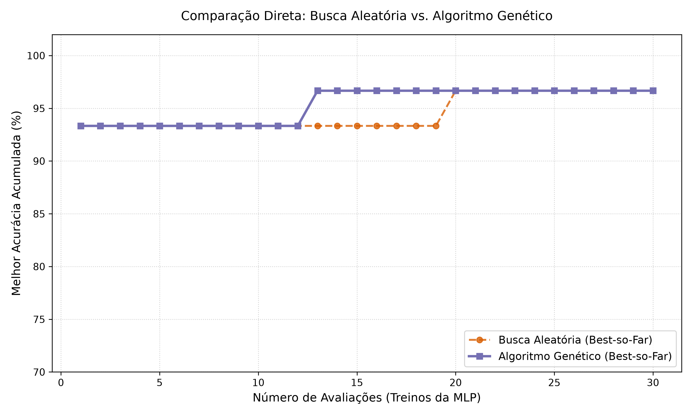
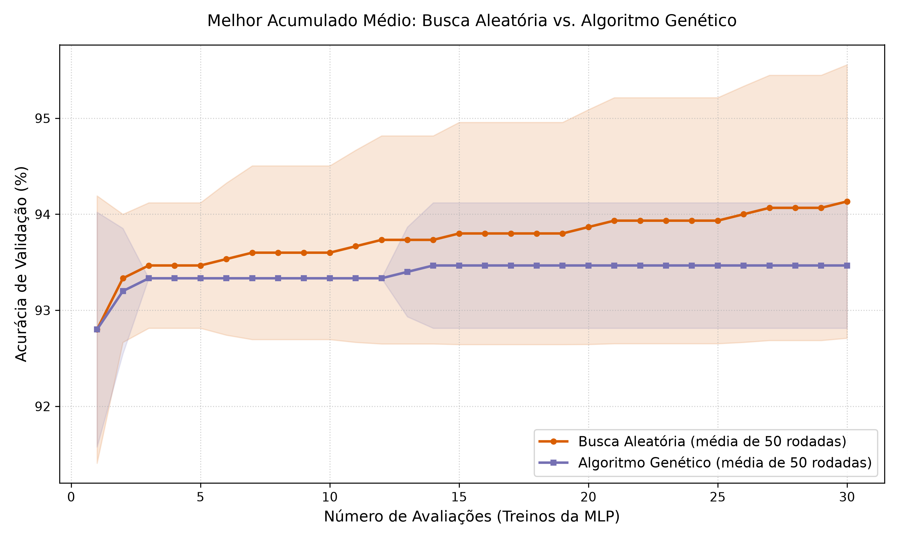

# Otimização de hiperparâmetros de uma MLP

Comparação entre **Busca Aleatória** e **Algoritmo Genético** para escolher os hiperparâmetros de uma rede neural MLP.

Cada vez que um algoritmo testa uma combinação, ele **treina a MLP** e mede a **acurácia de validação**.

## Os algoritmos

### MLP (o modelo)
Uma rede neural simples (*Multi-Layer Perceptron*) para classificação. 
Os algoritmos não mexem nos pesos, só escolhem seus hiperparâmetros.

Detalhes da arquitetura e do treino em [`model/README.md`](model/README.md).

### Busca Aleatória
1. Sorteia uma combinação de hiperparâmetros dentro do espaço de busca.
2. Treina a MLP e anota a acurácia de validação.
3. Repete até acabar o orçamento de avaliações.
4. Devolve a melhor combinação encontrada.

É simples, não depende de nenhum parâmetro de controle e serve como *baseline*.

### Algoritmo Genético
 Cada combinação de hiperparâmetros é um **indivíduo**, e um conjunto deles forma uma **população**.

1. **População inicial:** indivíduos sorteados aleatoriamente.
2. **Avaliação:** treina a MLP de cada indivíduo e calcula o fitness.
3. **Seleção:** os melhores indivíduos são escolhidos como pais.
4. **Cruzamento:** mistura os hiperparâmetros de dois pais para gerar filhos.
5. **Mutação:** altera aleatoriamente alguns valores, para manter variedade e explorar novas regiões.
6. **Nova geração:** os filhos (e, se houver elitismo, os melhores da geração anterior) formam a próxima população.
7. Repete os passos 2 a 6 até acabar o orçamento de avaliações.


## Espaço de busca

Definido em `config/espaco.py`:

| Hiperparâmetro | Descrição |
|---|---|
| `neuronios` | Número de neurônios da camada oculta |
| `taxa_aprendizado` | Taxa de aprendizado do otimizador |

## Metodologia

- Os dois métodos têm o **mesmo orçamento** de 30 avaliações (30 treinos da MLP).
- Cada método roda **50 vezes** com seeds diferentes, para medir a variação entre rodadas.
- O fitness usado na busca é a **acurácia de validação**.
- A melhor configuração de cada rodada é avaliada **uma única vez no conjunto de teste**, que nunca é usado para escolher hiperparâmetros.

## Estrutura do projeto

```
MLP/
├── README.md
├── requirements.txt
├──.gitignore
├── config/
│   ├── base.py                  # parâmetros gerais (seeds, orçamento, rodadas)
│   └── espaco.py                # espaço de busca dos hiperparâmetros
├── algoritmos/
│   ├── busca.py                 # busca aleatória
│   └── algoritmo_genetico.py    # algoritmo genético
├── model/
│   ├── README.md                # documentação do modelo
│   └── mlp.py                   # MLP, avaliar_configuracao, avaliar_no_teste
├── utils/
│   └── graficos.py              # funções que geram as figuras
├── notebook_analise/
      └── avaliacao.ipynb          # execução dos experimentos e análise
      └── graficos/                    # figuras geradas
```

## Como executar

### 1. Preparar o ambiente

```bash
git clone https://github.com/Projeto-IA-Tema-12/MLP.git
cd MLP

python -m venv .venv
source .venv/bin/activate        # Linux/macOS
# .venv\Scripts\activate         # Windows

pip install -r requirements.txt
```

### 2. Abrir o notebook

**No VS Code:**
1. Abra a pasta `MLP` (a raiz do projeto).
2. Abra `notebook_analise/avaliacao.ipynb`.
3. No canto superior direito, escolha o kernel `.venv`.
4. Clique em **Run All** (ou rode as células em ordem).

**No Jupyter:**
```bash
pip install jupyter
jupyter notebook notebook_analise/avaliacao.ipynb
```

## O notebook (`notebook_analise/avaliacao.ipynb`)

Ele executa todo o experimento e a análise. As células, em ordem:

1. **Imports e caminho.** Adiciona a raiz do projeto ao `sys.path` (para achar `model/`, `algoritmos/` e `utils/`, já que o notebook fica numa subpasta) e importa as funções.
2. **Configuração.** Define `NUM_RUNS = 50`, o número de rodadas de cada método.
3. **Execução dos experimentos.** Para cada seed de 0 a 49, roda a Busca Aleatória e o Algoritmo Genético e guarda os resultados (`res_busca` e `res_ga`).
4. **Gráficos de convergência.** Mostra o melhor acumulado médio por avaliação, com faixa de variação, para cada método e para a comparação entre os dois (salvos em `graficos/`).
5. **Avaliação no teste.** Pega a melhor rodada de cada método e avalia no conjunto de teste, imprimindo a acurácia e a matriz de confusão.

> A execução completa treina a MLP várias vezes (2 métodos × 50 rodadas × 30 avaliações), então pode levar alguns minutos.

## Resultados

- Melhor combinação encontrada pelos dois métodos: `neuronios = 5`, `taxa_aprendizado = 0.001`.
- Acurácia de validação e de teste: **96,67%** nos dois casos.
- No gráfico de convergência, a Busca Aleatória termina com média um pouco maior, mas as faixas de variação dos dois métodos se sobrepõem bastante. Com um espaço de busca pequeno e um conjunto de teste de 30 exemplos, a diferença não é conclusiva.

### Resumo Estatístico das 50 Rodadas

| Método | Validação (Média ± Desvio) | Validação (Min / Max) | Teste (Média ± Desvio) |
| :--- | :--- | :--- | :--- |
| **Busca Aleatória** | 94.13% ± 1.42% | 93.33% / 96.67% | 96.53% ± 1.15% |
| **Algoritmo Genético** | 93.47% ± 0.65% | 93.33% / 96.67% | 96.93% ± 1.74% |

### Análise dos Achados
- **Melhor combinação encontrada pelos dois métodos:** `neuronios = 5`, `taxa_aprendizado = 0.001`.
- **Acurácia de validação e de teste:** 96,67% nos dois casos.
- **Matriz de confusão no conjunto de teste:**
  [10 0  0]
  [0  9  1]
  [0  0 10]
  
- **Comparação entre os métodos:** No gráfico de convergência, a Busca Aleatória termina com média um pouco maior na validação, mas as faixas de variação dos dois métodos se sobrepõem bastante. Com um espaço de busca pequeno ($27 \text{ neurônios} \times 4 \text{ taxas} = 108 \text{ combinações}$) e um conjunto de teste de 30 exemplos, a diferença não é conclusiva.

---

### Comparação com apenas uma rodada


### Melhor acumulado 



* **Comparação entre os métodos:** No gráfico de convergência, a Busca Aleatória termina com média um pouco maior na validação, mas as faixas de variação dos dois métodos se sobrepõem bastante. Com um espaço de busca pequeno ($27 \text{ neurônios} \times 4 \text{ taxas} = 108 \text{ combinações}$) e um conjunto de teste de 30 exemplos, a diferença não é conclusiva.

---

